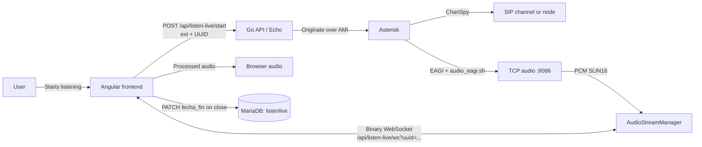
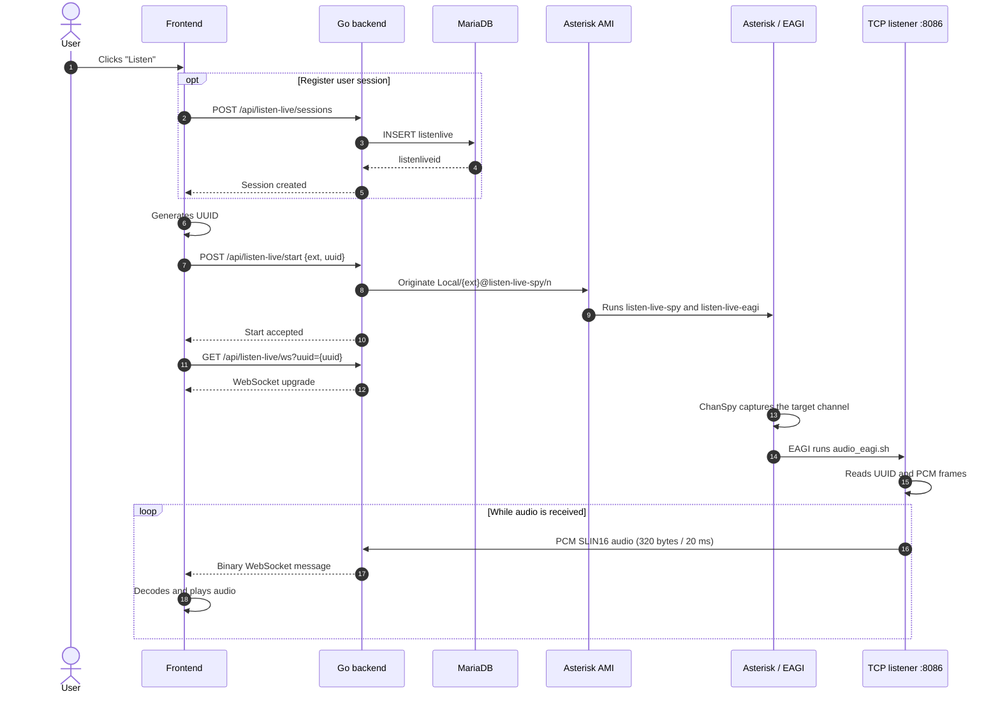
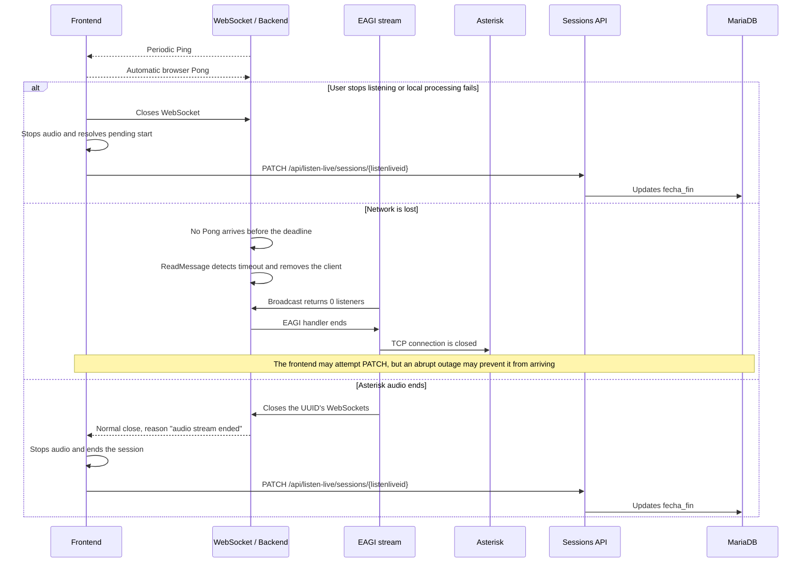

# Listen Live

Listen Live lets you listen in a browser, in real time, to audio from a SIP extension or the local node. Asterisk captures the audio; the Go backend transports it over WebSocket; the frontend processes and plays it.

## Overview

The UUID correlates Asterisk's audio stream with the WebSocket. The MariaDB listening session is identified by `listenliveid` and belongs to a user; these identifiers serve different purposes.

## Starting and routing audio

The active backend configuration is `ListenModeEAGI`. In this mode, the `audio_eagi.sh` script first sends the UUID (36 bytes), then the audio to the TCP listener. Each typical frame is 320 bytes: PCM SLIN16, 8 kHz, approximately 20 ms.

## PJSIP and dialplan prerequisites

To listen to an extension, it must exist as a PJSIP endpoint in `pjsip.conf`, and Asterisk must have the `res_pjsip` module available. Amerimon can manage endpoints from **Admin → PJSIP extensions**; new extensions default to the `sip-phones` context. Module settings and the phone dialplan context are installed additively from `pjsip-modules-patch.conf` and `pjsip-extensions-sip-phones-patch.conf`. See **PJSIP for SIP phones** in the [technical operations manual](manual-tecnico) for installation behavior, backups, and handling existing routes.

The PJSIP patch routes calls from the phone through a Local channel to `rpt-internal` before entering `app_rpt`. It does not replace a custom `_X.` route: if one already exists in `[sip-phones]` or `[rpt-internal]`, post-install preserves it and logs a warning. In that case, verify that the route still sends the call through a Local channel and reaches `Rpt(${NODE},Pv)` in a way compatible with the installation.

Post-install adds missing PJSIP directives to `modules.conf` even when `.so` files are not found, converts `noload` to `load` for modules enabled by the patch, and attempts to load them if Asterisk is running. It loads infrastructure and base resources first, checks for `Running` status, and retries dependencies while progress continues. If activation remains incomplete, it exits with an error displaying Asterisk's response without removing the configuration. It does not restart Asterisk; if Asterisk is stopped, settings take effect at the next start. Listen Live also requires `[listen-live-spy]` and `[listen-live-eagi]`, which post-install adds if missing. Existing contexts are preserved.

## Disconnects and end of session

The WebSocket uses a heartbeat: the server sends a Ping every 25 seconds, waits for a Pong, and considers the client disconnected after 60 seconds without a response. Writes also have a 10-second deadline. If an audio write fails, the backend removes and closes that client.

When EAGI detects that there are no listeners left, it closes its TCP connection; when the handler ends, the WebSockets associated with the UUID are closed. If the stream never had any listeners, EAGI waits up to 15 seconds before exiting.

### Who updates `fecha_fin`

Closing the WebSocket **does not directly update MariaDB** in the current backend. The frontend must retain the `listenliveid` returned when the session is created and call `PATCH /api/listen-live/sessions/{id}` with an RFC3339 timestamp when playback stops or ends. The route verifies that a regular user can only close their own session.

This works for closures the browser can process. If the browser process exits or the network disappears abruptly, the PATCH may not arrive; the heartbeat detects the dead connection and stops the audio stream, but does not close the database row by itself.
