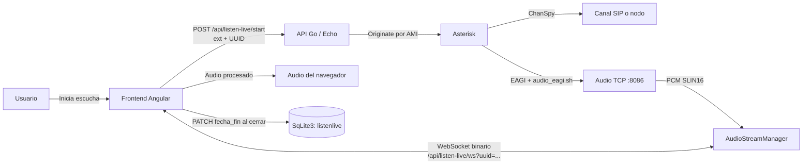
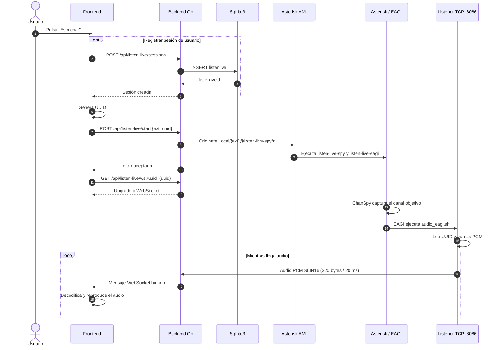
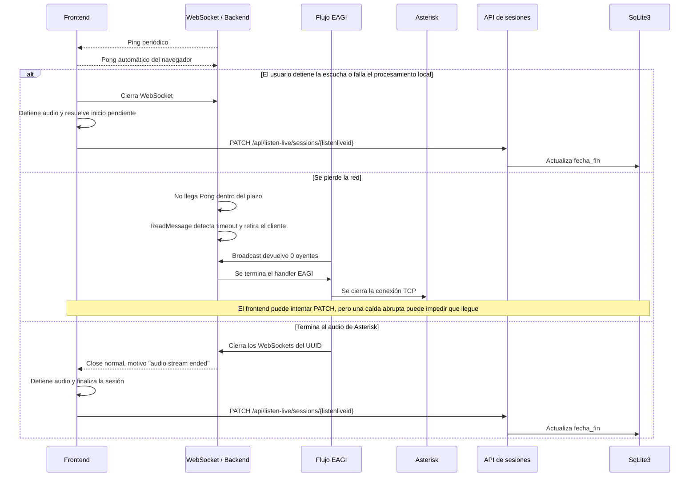

# Listen Live

Listen Live permite escuchar en el navegador el audio de una extensión SIP o del nodo local, en tiempo real. Asterisk captura el audio; el backend Go lo transporta por WebSocket; el frontend lo procesa y reproduce.

## Vista general

El UUID correlaciona el flujo de audio de Asterisk con el WebSocket. La sesión de escucha de SqLite3 se identifica por `listenliveid` y pertenece a un usuario; son identificadores con funciones distintas.

## Inicio y recorrido del audio

La configuración activa en el backend es `ListenModeEAGI`. En este modo, el script `audio_eagi.sh` envía primero el UUID (36 bytes) y luego el audio al listener TCP. Cada trama habitual tiene 320 bytes: PCM SLIN16, 8 kHz, aproximadamente 20 ms.

## Requisitos PJSIP y dialplan

Para escuchar una extensión, esta debe existir como endpoint PJSIP en `pjsip.conf` y el módulo `res_pjsip` debe estar disponible en Asterisk. Amerimon puede administrar endpoints desde **Admin → Extensiones PJSIP**; las extensiones nuevas usan por defecto el contexto `sip-phones`. La configuración de módulo y el contexto de teléfonos se instalan de forma aditiva mediante `pjsip-modules-patch.conf` y `pjsip-extensions-sip-phones-patch.conf`. Consulta la sección **PJSIP para teléfonos SIP** del [manual técnico](manual-tecnico) para el flujo de instalación, respaldos y resolución de conflictos con rutas existentes.

El parche PJSIP enruta las llamadas del teléfono por un canal Local hasta `rpt-internal` antes de entrar a `app_rpt`. No reemplaza una ruta `_X.` personalizada: si ya existe en `[sip-phones]` o `[rpt-internal]`, el postinstall la conserva y muestra un aviso. En ese caso hay que verificar que la ruta mantenga el encaminamiento por canal Local y llegue a `Rpt(${NODE},Pv)` de forma compatible con la instalación.

El postinstall agrega las directivas PJSIP que faltan en `modules.conf` aunque no encuentre los archivos `.so`, convierte `noload` en `load` para los módulos que el parche habilita e intenta cargarlos si Asterisk está activo. Carga primero la infraestructura y los recursos base, comprueba el estado `Running` y reintenta dependencias mientras haya progreso. Si faltan módulos requeridos, termina con error mostrando la respuesta de Asterisk, sin retirar la configuración. El módulo de eventos entre servidores `res_pjsip_publish_asterisk.so` es opcional: un fallo genera un aviso sin bloquear la instalación si los demás módulos están activos. Los diagnósticos buscan los archivos en `astmoddir` y rutas habituales, sin asumir una ruta fija. No reinicia Asterisk; si está detenido, la configuración se aplica al próximo inicio. El dialplan de Listen Live requiere además los contextos `[listen-live-spy]` y `[listen-live-eagi]`, que el postinstall agrega si faltan. Los contextos existentes se conservan.

## Desconexiones y fin de sesión

El WebSocket usa heartbeat: el servidor envía Ping cada 25 segundos, espera Pong y considera desconectado al cliente tras 60 segundos sin respuesta. También hay un límite de 10 segundos para escrituras. Si una escritura de audio falla, el backend elimina y cierra ese cliente.

Cuando EAGI detecta que ya no quedan oyentes, cierra su conexión TCP; al terminar el handler se cierran los WebSockets asociados al UUID. Si el flujo nunca llegó a tener oyentes, EAGI espera hasta 15 segundos antes de terminar.

### Quién actualiza `fecha_fin`

El cierre del WebSocket **no actualiza directamente SqLite3** en el backend actual. El frontend debe conservar el `listenliveid` devuelto al crear la sesión y llamar a `PATCH /api/listen-live/sessions/{id}` con una fecha RFC3339 al detener o finalizar la reproducción. La ruta verifica que un usuario normal solo cierre su propia sesión.

Esto funciona para cierres que el navegador puede procesar. Si el proceso del navegador termina o la red desaparece abruptamente, el PATCH podría no llegar; el heartbeat detecta la conexión muerta y detiene el flujo de audio, pero no cierra por sí solo la fila de la tabla.
